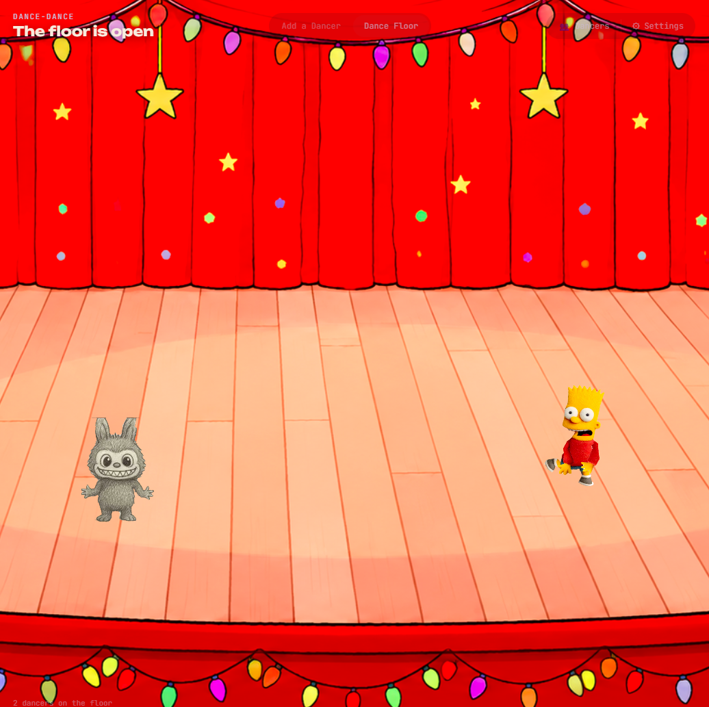

<div align="center">



# Dance-Dance

[](https://github.com/orgs/Chumbaka-Asia/repositories?q=topic%3Aplayground-commons)

A shared dance floor: children draw a character, photograph it, and watch it dance among everyone else's drawings to real motion-capture moves.

[Overview](#overview) • [Features](#features) • [Getting Started](#getting-started) • [Exhibition Mode](#exhibition-mode) • [Settings](#settings) • [Export, Import & Gallery](#export-import--gallery) • [How It Works](#how-it-works) • [Project Structure](#project-structure)

</div>

## Overview

Dance-Dance lets a child draw *any* human-ish figure, photograph it, and see their own drawing join a dance floor of accumulating dancers. Each drawing bends and moves through real motion-capture dances, using the same As-Rigid-As-Possible (ARAP) mesh deformation as Meta's [Animated Drawings](https://github.com/facebookresearch/AnimatedDrawings) project, running in the browser instead of a Python/OpenGL pipeline.

It is built in the shape of `flutterby` (colour a template → scan → watch it come alive → accumulate into a shared scene), and adapted from three parts of Animated Drawings (vendored under [`external/`](external/)): its **ARAP mesh solver**, its **BVH motion-capture dances** and its **joint/skeleton concept**. Its non-portable pieces (a custom-trained drawing pose detector that needs Docker/TorchServe, and a PyTorch/OpenGL renderer) are replaced by a silhouette-based skeleton fit with a manual tap-to-place fallback, and a WebGL renderer.

The application has three pages:

| Page | Purpose |
| --- | --- |
| [`dance-dance.html`](dance-dance.html) | The dance floor. It has an **Add a Dancer** tab (photograph a drawing, remove the background, rig it, pick a dance), a **Dance Floor** tab, a 👥 **Dancers** manager and ⚙ **Settings** |
| [`upload.html`](upload.html) | Phone-friendly version of **Add a Dancer**, for scanning on a phone while the floor plays on a bigger screen |
| [`gallery.html`](gallery.html) | Standalone viewer for exported dance-floor JSON files |

There are two ways to run it:

- **Single computer** — Open the HTML files directly in a browser. Dancers are saved in the browser (IndexedDB, with a `localStorage` fallback), and tabs stay in sync through the BroadcastChannel API.
- **Exhibition** — Run the hub server (`scripts/server.py`). Any number of phones on the same Wi-Fi can send dancers to one shared dance-floor screen.

**Zero dependencies:** no build step, no `package.json`, no `npm install`. The app is plain HTML, CSS and JavaScript, and the dances are pre-baked into `scripts/dances.js`. The exhibition server uses the Python 3.7+ standard library only. The pages load the Unbounded and JetBrains Mono fonts from Google Fonts, so without a network connection they fall back to system fonts; everything else works offline.

## Features

### Dancers

- **Any drawing works** — A filled body with a reasonably closed outline gives the cleanest cutout. The paper does not have to be white, evenly lit or shadow-free.
- **Automatic background removal** — The photo is cut out at several sensitivities and the best-scoring result wins. A sensitivity slider and a keep/erase brush fix a bad cutout by hand.
- **Automatic skeleton fit** — The skeleton is fitted from the silhouette's geometry (no ML), with a drag-the-dots joint editor as a fallback and corrector.
- **Surprise dance** — A random dance is picked (never the same one twice in a row), baked and shown immediately on one confirm screen. **Fix cutout**, **Adjust joints** and **Change dance** open the manual editors.
- **Five real dances** — `jesse_dance`, `jumping_jacks`, `dance_short`, `bye_giant` and `dash_proud`, baked from BVH motion-capture files.
- **Optional name** — A dancer's name (up to 40 characters) shows in the Dancers manager and the gallery.
- **Print template** — [`colouring-templates/template.jpg`](colouring-templates/template.jpg) is a character template to colour in, and [`dance-template.pdf`](colouring-templates/dance-template.pdf) is a printable sheet. [`figure-guide.png`](colouring-templates/figure-guide.png) is an optional A-pose outline for children who want a proportions guide. Neither is required.

### Dance floor

- **Independent dancers** — Every dancer has its own baked frames, phase offset and slight tempo jitter, so the floor never looks like one synchronised loop. A ground shadow gives each dancer some depth.
- **Entrances and spotlight** — New dancers make an entrance, and a recurring spotlight picks out one dancer at a time. See [Settings](#settings).
- **Stage rotation** — Everyone ever added is saved. **Dancers on stage** limits how many dance at once, and the rest take turns backstage.
- **Demo dinosaurs** — The bundled dinosaur drawing dances on the floor by default. Settings controls how many appear (0–40); demo dancers are never saved or shared.
- **Stage backdrop** — An illustrated curtain-and-floor scene.
- **Custom header and join code** — Change the title and subtitle, and show a QR code on the floor that sends phones to the upload page (or to a custom URL).
- **Background music** — Three tracks, muted by default. A credit line for the current track shows on the display.
- **Dancers manager** — The 👥 **Dancers** panel lists every saved dancer and removes any of them.
- **Settings panel** — Controls for music, demo dinosaurs, stage size, spotlight, dancer size, header text, join code and floor data. See [Settings](#settings).

### Sync & Persistence

- **Single computer** — Dancers are stored in the browser's IndexedDB (falling back to `localStorage`) and sent between tabs with BroadcastChannel and a small `localStorage` ping.
- **Exhibition** — Dancers sent from `upload.html` are stored in `dancers-data.json` on the hub computer and sent to display screens with Server-Sent Events (SSE).
- **Export, import & gallery** — Export the whole floor as a JSON file, restore it later, or browse it in `gallery.html`. See [Export, Import & Gallery](#export-import--gallery).

Every piece in this collection honours `prefers-reduced-motion`: motion is calmed, never blocked.

## Getting Started

No installation or build step is needed. Open the files directly in any modern browser. For a multi-device setup, see [Exhibition Mode](#exhibition-mode).

### Quick start (single computer)

1. Open `dance-dance.html` in a browser tab.
2. Click **Add a Dancer**, or open `upload.html` in another tab of the same browser.
3. Photograph or choose a picture of a drawing. The background is removed and the skeleton fitted automatically.
4. Check the dancer on the confirm screen. Use **Fix cutout**, **Adjust joints** or **Change dance** if you want to change anything, then click **Join the floor**.
5. Switch to the **Dance Floor** tab. The dancer joins the floor.

> [!NOTE]
> The pages must be opened in the same browser to share dancers in this mode. To share dancers between devices, use [Exhibition Mode](#exhibition-mode).

### Quick start (exhibition)

Use this when children add drawings from phones to one big screen.

1. Print some copies of `colouring-templates/dance-template.pdf` and hand out colouring materials.
2. Connect the hub computer and all other devices to the same Wi-Fi. A travel router works best.
3. On the hub computer, double-click `start.bat`. A window opens and shows the addresses.
4. On the display screen, open the "Dance floor screen" address in a browser. Press **F11** for full screen.
5. On each phone, open the "Phone upload" address.
6. Children photograph their drawing, check the result and tap **Join the floor**. The dancer appears on the display within a few seconds.

When you are done, press **Ctrl+C** in the `start.bat` window to stop the hub. To start fresh next time, see [Between sessions](#between-sessions).

For more detail, see [Exhibition Mode](#exhibition-mode).

## Exhibition Mode

Run a local hub server so multiple phones can send dancers to a single shared dance-floor screen over Wi-Fi. No internet connection is needed apart from the Google Fonts noted in the [Overview](#overview).

### Requirements

- Python 3.7+ on the hub computer (standard library only, no `pip install`)
- All devices on the same Wi-Fi network

### Setup

**On the hub computer** (the one connected to the display screen):

1. Double-click `start.bat`, or run `python scripts/server.py` from the project folder. To use a different port, add it at the end: `python scripts/server.py 8080`. The default port is 9000.
2. The server prints the addresses to use:

   ```text
   Dance-Dance — Hub Server
   Started at 14:30
   Dance floor screen  →  http://localhost:9000/dance-dance.html
   Phone upload        →  http://192.168.1.5:9000/upload.html
   Press Ctrl+C to stop the server
   ```

3. Open the dance-floor address in a browser on the display screen.

**On each phone** (any device on the same Wi-Fi):

1. Open the "Phone upload" address in a browser.
2. Add a dancer. It appears on the display screen within a few seconds.

> [!TIP]
> Write the upload address on a card at each station so visitors can type it in easily. If you don't know the hub's IP address, run `ipconfig` on the hub computer.

### Network options

| Option | Setup | Notes |
| --- | --- | --- |
| Venue Wi-Fi | Connect all devices to the existing Wi-Fi | No setup, but depends on the venue's network |
| Travel router | Plug in a router and connect all devices to it | Self-contained, no internet needed. **Recommended** |
| Windows Mobile Hotspot | Turn on in Settings → Network → Mobile Hotspot | No extra hardware. One-time setup on the hub computer |

> [!NOTE]
> A travel router creates a private Wi-Fi network that does not depend on the venue's internet.

### Between sessions

- To remove one dancer, open 👥 **Dancers** on the display screen and click the **×** beside it. This also deletes it from the hub's `dancers-data.json` and from every connected screen.
- **Clear** and **Clear all dancers** only empty the browser's own saved dancers. They do not touch the hub, so the hub's dancers come back the next time the display reloads. To wipe the hub, stop the server (Ctrl+C), delete `dancers-data.json`, then start it again.
- If the hub computer restarts, dancers load again from `dancers-data.json`.
- The display shows up to **Dancers on stage** dancers at once. The rest stay saved and take turns.

### Server API

| Method | Path | Purpose |
| --- | --- | --- |
| `GET` | `/api/dancers` | Return all dancers as a JSON array |
| `POST` | `/api/submit` | Add a dancer, save it and send it to all display screens. The body must include `textureDataURL` and `mesh` |
| `DELETE` | `/api/dancers/<id>` | Remove one dancer and tell all display screens |
| `GET` | `/api/events` | SSE stream (`new-dancer` and `remove-dancer` events) |
| `GET` | any other path | Serve files from the project folder |

The server sends a keep-alive ping every 30 seconds on each SSE connection and allows cross-origin requests (CORS) on the API. It writes `dancers-data.json` after every change, so restarting the hub does not discard the floor.

## Settings

Click ⚙ **Settings** in the top bar of `dance-dance.html` to open the settings panel. Everything except the music switch is remembered by the browser. Music is muted every time the page loads.

| Section | Control | What it does |
| --- | --- | --- |
| **Background music** | Enable / Mute | Turns the background music on or off. Muted by default. |
| | Repeat current song | Keeps replaying the current track instead of moving on to the next. |
| **Demo dinosaurs** | 0–40 | Number of built-in dinosaur demo dancers. Default is 1. Existing saved settings are respected; use Reset settings or set this slider to 1 to show the demo. |
| **Dancers on stage** | 10–300 | How many real dancers dance at once. Default is 50. Everyone is saved; the rest take turns backstage. |
| **Spotlight** | On / Off | Turns the recurring spotlight on or off. |
| | Spotlight every… (6–30 s) | How often the spotlight moves to another dancer. Default is 12 s. Shown only when the spotlight is on. |
| **Dancer size** | 50%–200% | Overall dancer size. Default is 100%. |
| **Display text** | Title / Subtitle | Replaces "The floor is open" and "Dance-Dance" in the header. Leave a field empty to use the default. |
| **Join code** | Show / Hide | Shows a QR code at the bottom left of the floor. |
| | URL | **Upload page (auto)** encodes the hub's `upload.html` using the server's LAN address (`/api/host-info`). **Custom URL** encodes any address you type. Opened from `file://`, only Custom is available. |
| **Floor data** | Export / Import / Clear | Download, restore or remove the whole floor. See [Export, Import & Gallery](#export-import--gallery). |
| | Reset settings | Sets every control above back to its default. |

> [!WARNING]
> **Clear** and **Clear all dancers** remove every dancer saved in this browser, and cannot be undone. Both ask for confirmation first. In exhibition mode they do not delete the hub's copy (see [Between sessions](#between-sessions)). Export the floor first if you want to keep it.

### Managing dancers

Click 👥 **Dancers** in the top bar to list every saved dancer, newest first, including those backstage. Each row shows the dancer's thumbnail, name (or **Unnamed dancer**), dance and an **on stage** or **backstage** badge. Click **×** to remove one dancer (in exhibition mode this also removes it from the hub), or **Clear all dancers** to empty this browser's floor.

### Background music and adding songs

Music starts muted on every page load. In Settings, use **Enable / Mute** to control playback and **Repeat current song** to loop one song instead of cycling through the playlist.

The playlist is defined explicitly in the `MUSIC_TRACKS` array in [dance-dance.html](dance-dance.html). Adding files to `sounds/` and updating its README does **not** automatically add songs to the playlist. To add a song:

1. Put its MP3 file in [sounds/](sounds/).
2. Add its attribution details to [sounds/README.md](sounds/README.md).
3. Add an entry to `MUSIC_TRACKS` with `file` (the relative path, such as `sounds/my-song.mp3`), `artist` (the credited name), `artistUrl` (the artist attribution link) and `sourceUrl` (the source attribution link). Copy the names and URLs from the song's attribution details, following the existing entries.

## Export, Import & Gallery

### Export

Open ⚙ **Settings** and click **Export** under **Floor data** to download a JSON file (`dance-dance-floor-YYYY-MM-DD.json`) with every dancer, including its texture (as a data URL), mesh, skeleton, name and dance. In exhibition mode, the export is the hub's full dancer list. On a single computer, it is the list stored in this browser.

You can also remove a single dancer from the 👥 **Dancers** panel with its **×** button.

### Import

Click **Import** in the same panel and choose a previously exported JSON file. The file must be a list of dancers, each with an `id`, `mesh`, `skeleton` and `textureDataURL`. After you confirm, the import **replaces** the current floor with the file's dancers, saved in this browser. If the file is not a Dance-Dance export, nothing changes.

### Gallery page

Open [`gallery.html`](gallery.html) in a browser, including directly from your files. Choose or drop an exported JSON file (or the hub's `dancers-data.json`) to browse every dancer's drawing, name, dance, ID and join date.

- Search by name or ID
- Filter by dance, and sort by export order, newest first or oldest first
- Click **Download HTML gallery** to save a self-contained copy that opens with every dancer already loaded. The search, filter and sort controls work in the downloaded file too. Keep the original JSON file if you want to import the dancers back onto the floor.

The gallery is one HTML file with no server or Python step. It reads the file in your browser only, and does not change the file or the live dance floor. An unnamed dancer appears as **Unnamed dancer**. Records without a usable embedded image are skipped, and the page tells you how many were skipped.

## How It Works

### Image processing

On the **Add a Dancer** tab (or `upload.html`):

1. **Draw** a person (or person-ish figure) on paper. A filled body with a reasonably closed outline gives the cleanest cutout. The paper does not have to be white, evenly lit or shadow-free, and the desk showing along one edge is fine. What the cutout cannot guess at is a figure drawn in sparse hatching, or one that runs off the edge of the photo.
2. **Photograph or upload** the drawing, and that is usually the last decision you make:
   - **Background removal** runs automatically at several sensitivities. Each result is scored (a single dominant component, a sane fill ratio, a body thick enough to survive being eroded, no leaking off the frame edge, and an outline that lies along edges in the photo rather than across blank paper) and the best one wins.
   - **The skeleton is fitted automatically** from the silhouette's row-width profile (head blob, neck valley, shoulder width, hip valley, crotch split, foot and hand extremes). This is pure geometry with no ML, since human-pose models are unreliable on children's drawings. Per-joint confidence falls back to a bounding-box fit, so the result is always a usable starting rig.
   - A **surprise dance** is picked at random (avoiding the previous one), baked, and your dancer is shown dancing on a single confirm screen: a big **Join the floor** button, plus small **Fix cutout** / **Adjust joints** / **Change dance** links that open the manual editors below.
3. **If automation fails** (a cutout that fails the plausibility gate, or a silhouette the rigger can't read), the flow drops straight into the manual steps, which remain fully available:
   - **Background removal**: the page models the background from a band of pixels around the photo's border, as up to three *chroma* modes (paper, plus whatever else is in frame, a strip of desk say), each carrying its own coarse map of how the light falls across the frame. A pixel counts as background when it matches one mode's colour *and* its brightness is plausible for that spot: generously darker (a shadow under the drawing dims paper without tinting it) but barely lighter. Splitting "darker" from "a different colour" this way keeps shadows out of the figure and pale crayon fills in it, which a single flat colour distance cannot do.

     The page then floods "background" inward from the image border, seeded only where it is certain, and blocked both by colour and by strong edges in the photo. A gap in a drawn outline is therefore plugged by the line's own edge rather than leaking into the body. It keeps everything the flood *doesn't* reach, which fills interior holes (a white belly, light fills) regardless of colour. The largest connected region becomes the silhouette. The sensitivity slider and a threshold-free keep/erase brush hand-fix a bad automatic cutout (the same fallback Animated Drawings itself needs; its README says as much about its own ML segmentation).
   - **Place the joints**: drag each dot onto the matching spot on your drawing, pre-filled with the silhouette-aware guess, using the same joint set Animated Drawings' example characters use (root, hip, torso, neck, shoulders/elbows/hands, hips/knees/feet). This is a simplified stand-in for Animated Drawings' own "fixer app", which lets a person correct its ML pose detector's guesses by hand.
   - **Pick a dance** and bake: the drawing's silhouette is triangulated into a mesh (mirroring `_generate_mesh` in `animated_drawing.py`), ARAP is prefactored for that mesh once, and every frame of the chosen dance is solved and cached. This takes about a second, with a progress bar. **Preview** the loop, use **Change dance** to pick a different dance without re-rigging, then **Join the floor**.

The cutout's edge is feathered rather than a hard stencil, with the background colour unmixed back out of the partly covered pixels. The stored texture is cropped to the mesh's bounding box (the rectangle the renderer normalises its UVs against), downscaled to a 400 px long edge and encoded as transparent WebP at quality 0.85 (PNG fallback). Cropping first means those 400 px are spent on the figure rather than on empty margin, and none of it reduces the working resolution used for segmentation and rigging. All processing happens in the browser; no photo leaves it. Only the finished dancer (texture, mesh, skeleton, name and dance) is sent to the hub in exhibition mode.

### The dances

`scripts/bake_dances.py` parses the BVH motion-capture files shipped in `external/bvh/...` (vendored from [Animated Drawings](https://github.com/facebookresearch/AnimatedDrawings)) with a from-scratch, GL-free BVH parser and forward-kinematics walk. Animated Drawings' own `bvh.py` pulls in OpenGL transitively via a debug-visualisation widget, so this reimplements just the parsing and FK logic it documents. For each frame, it reads off the world-space 2D angle of the 10 body-part bones that Animated Drawings' own retarget configs (`external/retarget/*.yaml`, vendored) allow to move independently: torso, neck, both elbows, hands, knees and feet. Shoulders and hips move rigidly with the torso, exactly as those configs specify.

Different BVH sources (rokoko, fair1, cmu1 and [bandai](https://github.com/BandaiNamcoResearchInc/Bandai-Namco-Research-Motiondataset/tree/master/dataset/Bandai-Namco-Research-Motiondataset-1) motion capture) use different joint-naming conventions, so each dance uses the matching mapping from Animated Drawings' own per-source retarget config. The Bandai Namco Research Motiondataset uses a standard industrial skeleton with a single `Spine` and `Chest` (instead of `Spine1`/`Spine2`/`Spine3`) and `UpperArm`/`LowerArm` and `UpperLeg`/`LowerLeg` naming (instead of `LeftArm`/`LeftForeArm` and `LeftUpLeg`/`LeftLeg`).

This is a simplification of Animated Drawings' full PCA "twisted-perspective" retargeter (which projects each limb onto its own best-fit plane rather than one flat frontal view), a reasonable trade for a much smaller, pure-JS bake step. If a dance ever looks too flat, porting `retargeter.py`'s PCA step is the natural next upgrade.

### The dance floor

Every joined dancer keeps dancing independently, with its own baked frame cache, phase offset and slight tempo jitter. A ground-shadow pass (an offset, darkened second draw) gives each dancer some depth. The WebGL renderer in `scripts/renderer.js` draws front-to-back-sorted triangles so legs, head, torso and arms appear in the right depth order. Because every frame was baked at submit time, the runtime is just buffer uploads, not a live solve.

Persistence and sync mirror flutterby: IndexedDB stores texture Blobs without base64 overhead, with a `localStorage` fallback for contexts where IndexedDB cannot open (notably Chrome under `file://`). Legacy `localStorage` records and older PNG imports are re-encoded once through the current WebP/400 px pipeline.

### Sync mechanism

The pages check `window.location.protocol` to choose a mode:

| Mode | Address starts with | Live updates | Dancer storage |
| --- | --- | --- | --- |
| **Single computer** | `file:` | `BroadcastChannel('dance-dance')` plus a `localStorage` ping | IndexedDB (`dance-dance` database, `dancers` store), `localStorage` fallback |
| **Exhibition** | `http:` or `https:` | SSE from `/api/events` | `dancers-data.json` on the hub |

When a page is served over `http:`, the dance floor also keeps a local IndexedDB cache and merges the hub's dancer list into it. Settings are saved in the browser's `localStorage` (`dance-dance.settings`) in both modes.

> [!NOTE]
> A dancer added with **Add a Dancer** on the dance-floor page itself is saved locally and is not pushed to the hub. Only `upload.html` sends dancers to the hub, so use it for any dancer that other screens should see.

### Data flow

**Single computer** (files opened directly):

```text
[Upload page / Add a Dancer tab] -- BroadcastChannel --> [Dance floor]
              |                                              |
              +------------------ IndexedDB <----------------+
```

**Exhibition** (served by `scripts/server.py`):

```text
[Phone 1] -+
[Phone 2] -+-- POST /api/submit --> [server.py] -- SSE /api/events --> [Dance floor screen]
[Phone 3] -+                              |
                                   dancers-data.json
```

### Dancer object structure

Each dancer on the server or in an export file has these fields:

| Field | Type | Description |
| --- | --- | --- |
| `id` | string | Unique ID (the time plus a random suffix) |
| `name` | string | Name typed by the user (max 40 characters, may be empty) |
| `dance` | string | Dance id, one of the keys in `window.DanceData` (for example `jumping_jacks`) |
| `createdAt` | number | Time created, in milliseconds since 1970 |
| `mesh` | object | `{ vertices, triangles }` of the silhouette mesh |
| `skeleton` | array | Joints as `{ name, parent, loc }` |
| `textureDataURL` | string | WebP (or PNG) data URL of the cropped, cut-out drawing |

### Re-baking or adding dances

`scripts/dances.js` is generated, not hand-edited.

1. Drop a `.bvh` file under `external/bvh/` (matching the source subdir: `rokoko/`, `cmu1/`, `bandai/`, etc.). The shipped BVH files are vendored copies. For new sources, copy the BVH and its retarget config from the original [Animated Drawings](https://github.com/facebookresearch/AnimatedDrawings) repo into `external/`.
2. Add an entry to `DANCES` in `scripts/bake_dances.py`, picking (or adding) a `BONE_MAPPING_*` that matches its skeleton's joint-naming convention. Check the matching file under `external/retarget/` for the canonical mapping if it's a new source. The available mappings are `fair1`, `cmu1`, `rokoko` and `bandai`.
3. Regenerate `scripts/dances.js` (requires `numpy` installed in your Python environment):

   ```bash
   python scripts/bake_dances.py
   ```

   It writes `scripts/dances.js` next to itself.

### Tests

The Node tests in `test-files/` cross-check `scripts/arap.js` against the Python reference solver and exercise `scripts/figure-core.js`. Run them individually from the repository root:

```bash
node test-files/run_arap_js.js
node test-files/run_arap_js_big.js
node test-files/test_fk_rotation.js
node test-files/test_mesh_and_fk.js
node test-files/test_autofit_skeleton.js
```

`scripts/arap.js` is validated to match the Python original to about 1e-4 relative error. Nothing in `test-files/` is loaded by the app itself.

### What's deliberately different from Animated Drawings

- **Rigging**: Animated Drawings auto-detects a skeleton with a custom-trained pose model (Docker/TorchServe, about 16 GB RAM, not browser-portable). Dance-Dance instead fits the skeleton from the silhouette's geometry (automatic on the streamlined path, with the manual drag-the-dots editor as a fallback and corrector). There is no ML, it works on any drawing, and it mirrors the human-correction step their own pipeline already relies on via its fixer app.
- **Deformation math**: unchanged. `scripts/arap.js` is a direct, numerically validated port of `arap.py`.
- **Motion**: unchanged in spirit (real BVH mocap data, retargeted onto the same joint set Animated Drawings uses), but retargeted with a simpler frontal-projection bake instead of the full PCA twisted-perspective method.
- **Rendering**: Animated Drawings renders with PyTorch/OpenGL server-side or via a desktop app. Dance-Dance renders with WebGL in the browser, baking each dancer's deformed-mesh frames once at submit time so the runtime is just buffer uploads, not a live solve.

## Project Structure

```text
├── dance-dance.html         Dance floor, Add a Dancer tab, Dancers manager and Settings
├── upload.html              Phone-friendly Add a Dancer page
├── gallery.html             Viewer for exported dance-floor JSON files
├── start.bat                Double-click launcher for scripts/server.py
├── scripts/
│   ├── server.py            Hub server for exhibition mode
│   ├── figure-core.js       Segmentation, skeleton fit, mesh generation, FK, dancer records
│   ├── arap.js              ARAP mesh deformation (port of Animated Drawings' arap.py)
│   ├── renderer.js          WebGL renderer and DanceBaker
│   ├── template-cutout.js   Template stencil and photo alignment
│   ├── dances.js            Baked dance data (generated, do not hand-edit)
│   ├── demo-dino.js         Prepared mesh, skeleton and texture from the dinosaur sample
│   └── bake_dances.py       BVH to dances.js baker
├── colouring-templates/
│   ├── template.jpg         Character template to colour in
│   ├── dance-template.pdf   Printable template sheet
│   └── figure-guide.png     Optional A-pose proportions guide
├── images/
│   ├── 21-9.png             Stage backdrop (21:9)
│   ├── 4-3.png              Stage backdrop (4:3)
│   ├── chumbaka-logo.png    Logo shown in the header
│   ├── screenshot.png       Screenshot used in this README
│   └── test-dancer-dino.jpeg Source drawing for the built-in dinosaur demo
├── sounds/                  Background music tracks, with credits in README.md
├── external/                Vendored slice of Animated Drawings (read-only)
│   ├── bvh/                 BVH mocap files baked into dances.js
│   ├── retarget/            Reference retarget configs
│   └── animated_drawings/   Reference ARAP solver and licence
├── test-files/              Node tests, fixtures and a browser regression page
└── dancers-data.json        Hub server storage (created automatically)
```

## Acknowledgements

- The ARAP solver, BVH motion-capture files, retarget configs and joint concept come from Meta's [Animated Drawings](https://github.com/facebookresearch/AnimatedDrawings) (MIT-licensed, vendored under `external/`, licence in `external/animated_drawings/LICENSE`). One dance source is the [Bandai Namco Research Motiondataset](https://github.com/BandaiNamcoResearchInc/Bandai-Namco-Research-Motiondataset).
- Background music is from [Pixabay](https://pixabay.com/) by Mikko Virtanen, VibeHorn and Dmitrii Kolesnikov. Full links are in `sounds/README.md`.
- Fonts are [Unbounded](https://fonts.google.com/specimen/Unbounded) and [JetBrains Mono](https://fonts.google.com/specimen/JetBrains+Mono), loaded from Google Fonts.
